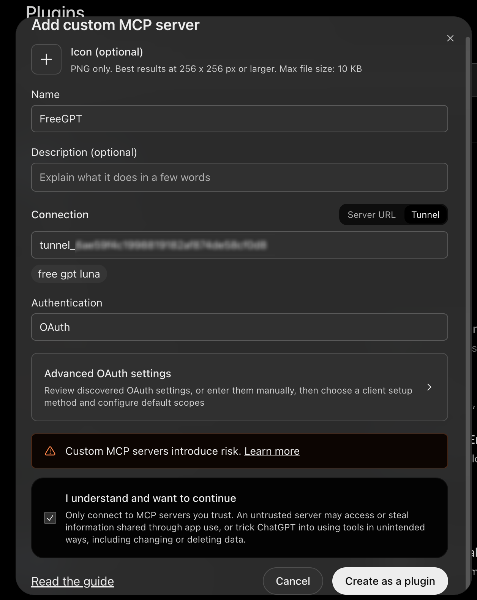

# ChatGPT Local Workspace

A small Go MCP server that lets ChatGPT list, search, read, and write files in a local workspace through OpenAI Secure MCP Tunnel.

The project is licensed under the [MIT License](LICENSE). Its Go dependencies have [separate license terms](third_party_licenses/README.md).

## Requirements

- macOS and [Homebrew](https://brew.sh/).
- Go 1.27 or newer when building from source.
- An OpenAI Platform account with access to [Tunnels](https://platform.openai.com/settings/organization/tunnels).
- A ChatGPT account and workspace that can add custom MCP servers.

## Install with Homebrew

Install and start the app with:

```bash
brew tap openai/tools
brew trust --formula openai/tools/tunnel-client
brew install openai/tools/tunnel-client
brew install noxhsxrk/nox/chatgpt-local-workspace
chatgpt-local-workspace
```

The OpenAI tunnel client is a dependency. Trust its formula and install it first so Homebrew can resolve it when installing this app. Warnings about other untrusted taps are unrelated to this installation.

The app checks GitHub for new stable releases and shows the result on the page. Select **Check for updates** to check again. To update, run `brew update && brew upgrade noxhsxrk/nox/chatgpt-local-workspace`, then restart the app. The Homebrew package may become available shortly after the GitHub release.

If the tap or project repository is private, your GitHub account must have access to both repositories and Git must be configured to authenticate with GitHub.

## Setup

### 1. Create a tunnel

In [OpenAI Platform](https://platform.openai.com/settings/organization/tunnels), create a tunnel, select your organization and ChatGPT workspace, then save the tunnel ID.


### 2. Create a runtime API key

Open [API keys](https://platform.openai.com/api-keys), create a runtime key with **Tunnels Read + Use** permissions, and save it somewhere secure. The screenshot shows the creation form; select restricted permissions where available.


### 3. Start the connection

If installed with Homebrew, run `chatgpt-local-workspace`. If using a project checkout, open Terminal in the project directory and run:

   ```bash
   ./start-tunnel.sh
   ```

The app opens in your browser automatically. If it does not, open the local URL printed in Terminal. Enter the tunnel ID, runtime API key, and an existing workspace directory, then select **Start connection**. Start with a test folder: the server can read and overwrite files in the selected workspace. Select **Add connection** to configure and run additional tunnels independently.

The launcher starts the local web app. When running from a checkout, install Go and the official OpenAI `tunnel-client` first using the Homebrew commands above. Leave Terminal open; press **Ctrl+C** to stop it. Each tunnel's API key is saved separately in macOS Keychain. Tunnel IDs and workspaces are saved locally so you can reconnect without entering them again. A new tunnel-client profile is created each time you start a connection.

Select the eye button next to a saved API key to reveal it after macOS device authentication. Touch ID or the device password can be used when available. This feature requires Apple's Swift command-line tools.

For the interactive terminal flow, run `./start-tunnel.sh --cli` from a project checkout.

## Connect ChatGPT

1. In ChatGPT, open **Plugins** and choose **Add custom MCP server**.
2. Under **Connection**, choose **Tunnel** and select or enter your tunnel ID.
3. Configure authentication if required, then create the plugin.
4. Open a chat, select the plugin, and ask it to list the files in your workspace. Confirm that the response contains actual file names.



The screenshot shows OAuth selected as an example. This server does not provide OAuth; choose no authentication if that option is available, rather than copying the OAuth selection in the image.

For troubleshooting, see the [OpenAI Secure MCP Tunnel guide](https://developers.openai.com/api/docs/guides/secure-mcp-tunnels).

To inspect MCP traffic, enable **Record MCP requests and responses** before starting a connection. Logs can contain file contents or other private information. They are stored in a private temporary file, capped at 2 MiB, and removed when the app exits normally. The log viewer shows up to the most recent 256 KiB. Tunnel traffic does not include ChatGPT model token usage, so the app cannot calculate it.

The optional **MCP traffic estimate** uses the current connection's recorded tool-call arguments and results. It approximates one token per four UTF-8 bytes and applies GPT-6 Luna standard short-context API rates ($0.10 input and $0.50 output per million tokens, checked October 31, 2026). It does not measure actual model usage or charges, and excludes chat history, reasoning, repeated context, caching, and traffic not present in the log. Estimates can be especially inaccurate for Thai and code. Check [current API pricing](https://developers.openai.com/api/docs/pricing) before using the comparison.

## Skills and agent profiles

Open **Agent skills** in the local app to search skills.sh or install a local folder containing `SKILL.md`. Online skills are downloaded from their public GitHub repositories. Review the source before installing; the app does not execute bundled scripts automatically. ChatGPT can list and read installed skills through the MCP tools. Automatic approval policies are not yet supported.

The app creates its own skill library at `~/Library/Application Support/chatgpt-local-workspace/skills` on macOS and displays its location in the app. It does not install skills into Codex's `~/.codex/skills` directory.

Open **Agent profiles** to save reusable instructions for ChatGPT. Profiles do not launch autonomous agents or models and cannot grant additional tool permissions. Do not put secrets in profile instructions. After updating, refresh or recreate the ChatGPT custom MCP connection if its new tools do not appear.

## External MCP servers

In **MCP servers**, add a trusted local stdio server or a Streamable HTTP server. Local commands run directly with the selected workspace as their working directory and the permissions of your user account. Put one argument per line, and name any additional environment variables to pass from the app's own environment. The tunnel runtime key is not passed to local servers.

Remote URLs require HTTPS; plain HTTP is permitted only for localhost. Optional HTTP bearer tokens are saved in macOS Keychain and are not sent across redirects. OAuth login and legacy HTTP/SSE transport are not supported. External servers are available to every tunnel in the app; only add servers you trust.

In ChatGPT, ask it to list configured MCP servers, inspect a server's tools, then use a specific tool. The bridge exposes `mcp_servers_list`, `mcp_server_tools`, and `mcp_server_call`. Tool results are returned as JSON text with a 256 KiB limit. A failed or timed-out call may still have changed data; check the outcome before retrying. Refresh or recreate the ChatGPT connection if these tools are not visible.

If ChatGPT reports that the MCP server is not initialized, make sure only one `tunnel-client` process is using this tunnel, restart the connection, and try a new chat. A running process does not by itself confirm that the tunnel is connected. Also verify that the ChatGPT plugin uses the same tunnel ID and workspace association.

## Notes

- Start with a test folder without sensitive files. The server can create and overwrite files without its own approval prompt.
- The built-in workspace tools cannot run shell commands, tests, or project web servers. Configured external MCP servers can run code or change data with the privileges you give them. This application is a prototype, not a production-hardened sandbox.
- Custom MCP access depends on your ChatGPT plan and workspace permissions. The tunnel does not provide unlimited usage.
