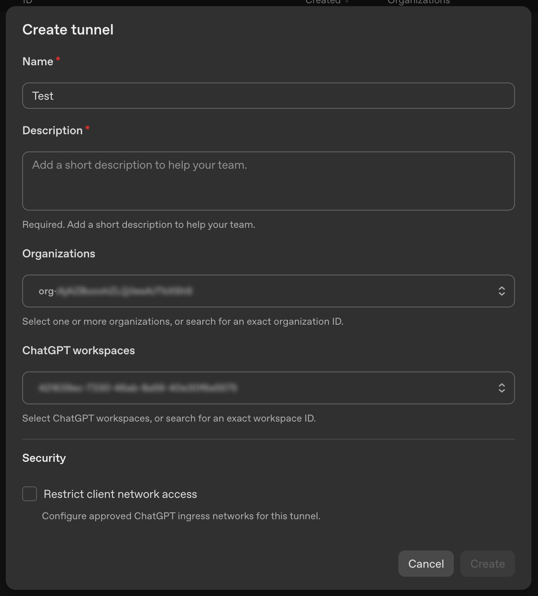
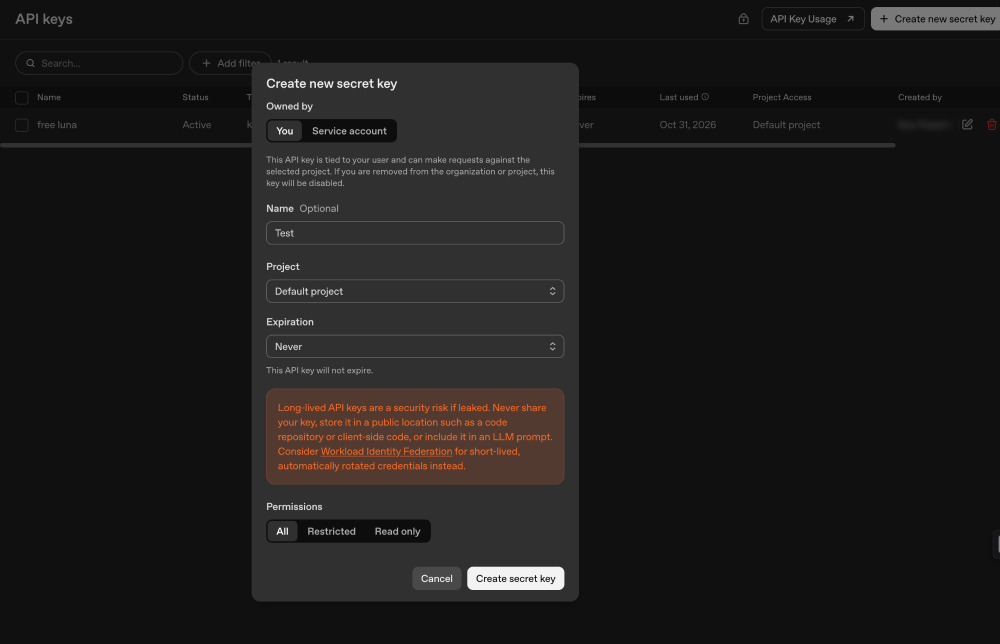

# ChatGPT Local Workspace

A small Go MCP server that lets ChatGPT list, read, and write files in a local workspace through OpenAI Secure MCP Tunnel.

## Requirements

- macOS and [Homebrew](https://brew.sh/).
- An OpenAI Platform account with access to [Tunnels](https://platform.openai.com/settings/organization/tunnels).
- A ChatGPT account and workspace that can add custom MCP servers.

## Install with Homebrew

Install and start the app with:

```bash
brew tap noxhsxrk/nox
brew install noxhsxrk/nox/chatgpt-local-workspace
chatgpt-local-workspace
```

If the tap or project repository is private, your GitHub account must have access to both repositories and Git must be configured to authenticate with GitHub.

## Setup

### 1. Create a tunnel

In [OpenAI Platform](https://platform.openai.com/settings/organization/tunnels), create a tunnel, select your organization and ChatGPT workspace, then save the tunnel ID.



### 2. Create a runtime API key

Open [API keys](https://platform.openai.com/api-keys), create a runtime key with **Tunnels Read + Use** permissions, and save it somewhere secure. The screenshot shows the creation form; select restricted permissions where available.



### 3. Start the connection

If installed with Homebrew, run `chatgpt-local-workspace`. If using a project checkout, open Terminal in the project directory and run:

   ```bash
   ./start-tunnel.sh
   ```

The app opens in your browser automatically. If it does not, open the local URL printed in Terminal. Enter the tunnel ID, runtime API key, and an existing workspace directory, then select **Start connection**. Start with a test folder: the server can read and overwrite files in the selected workspace.

The launcher installs Go and the official OpenAI `tunnel-client` with Homebrew if needed, then starts the local web app. Leave Terminal open; press **Ctrl+C** to stop it. The API key is saved in macOS Keychain. The tunnel ID and workspace are saved locally so you can reconnect without entering them again. A new tunnel-client profile is created each time you start a connection.

Select the eye button next to a saved API key to reveal it after macOS device authentication. Touch ID or the device password can be used when available. This feature requires Apple's Swift command-line tools.

For the interactive terminal flow, run `./start-tunnel.sh --cli` from a project checkout.

## Connect ChatGPT

1. In ChatGPT, open **Plugins** and choose **Add custom MCP server**.
2. Under **Connection**, choose **Tunnel** and select or enter your tunnel ID.
3. Configure authentication if required, then create the plugin.
4. Open a chat, select the plugin, and ask it to list the files in your workspace. Confirm that the response contains actual file names.


The screenshot shows OAuth selected as an example. This server does not provide OAuth; choose no authentication if that option is available, rather than copying the OAuth selection in the image.

For troubleshooting, see the [OpenAI Secure MCP Tunnel guide](https://developers.openai.com/api/docs/guides/secure-mcp-tunnels).

If ChatGPT reports that the MCP server is not initialized, make sure only one `tunnel-client` process is using this tunnel, restart the connection, and try a new chat. A running process does not by itself confirm that the tunnel is connected. Also verify that the ChatGPT plugin uses the same tunnel ID and workspace association.

## Notes

- Start with a test folder without sensitive files. The server can create and overwrite files without its own approval prompt.
- The server does not run shell commands, tests, or web servers. It is a prototype, not a production-hardened sandbox.
- Custom MCP access depends on your ChatGPT plan and workspace permissions. The tunnel does not provide unlimited usage.
